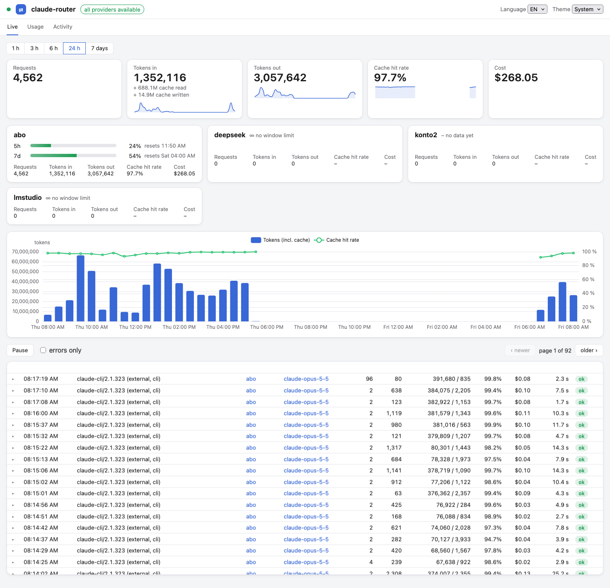
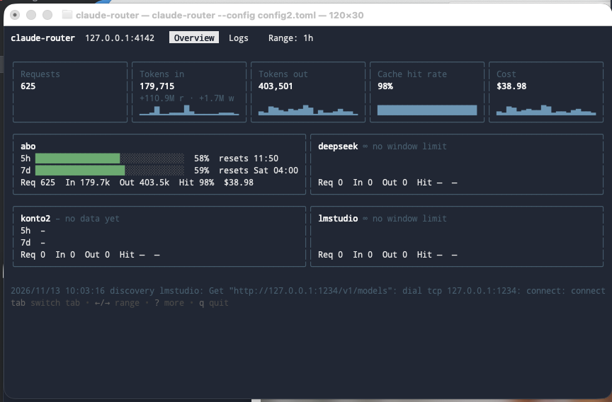

<div align="center">

# claude-router

**A local HTTP router between Claude Code and any LLM provider.**

Route by model name, translate Anthropic ↔ OpenAI, fall back automatically when your
subscription runs dry, and see every token and every cent in a built-in dashboard.

[](LICENSE)


[](https://spielernogard.github.io/claude-router/)



**[Documentation](https://spielernogard.github.io/claude-router/)** ·
[Getting started](https://spielernogard.github.io/claude-router/getting-started/) ·
[Configuration](https://spielernogard.github.io/claude-router/configuration/) ·
[Security](https://spielernogard.github.io/claude-router/security/)

</div>

## Features

- **One endpoint, many providers.** Claude Code (or any Anthropic-shaped client) talks to
  `http://127.0.0.1:4141`. `/model deepseek:deepseek-chat` goes to DeepSeek and
  `/model subscription:opus-5` goes to your Claude subscription. Requests to local
  models go to LM Studio, Ollama, vLLM or llama.cpp.
- **Format translation.** Anthropic Messages requests, including streaming and tool
  calls, are translated to OpenAI Chat Completions and back. Anthropic providers get
  a byte-for-byte passthrough.
- **Subscription fallback.** When a Claude subscription window is exhausted, requests move
  on to a second account or another provider until the window resets.
- **Usage and cost tracking.** Tokens, cache hits and costs are stored in SQLite and
  split into subscription equivalent and real spend.
- **Web UI.** A live request feed, rate-limit windows per account, usage breakdowns, an
  activity heatmap and a request/response inspector. It's embedded in the binary.
- **Stream watchdog.** Upstream streams that go silent are cut off with a clean SSE error
  instead of hanging.
- **Single static binary** for macOS, Linux and Windows.

## Install

Download the binary for your platform from the
[latest release](https://github.com/SpielerNogard/claude-router/releases/latest). The web UI
is built in. For example, on Apple Silicon:

```bash
curl -fsSL -o claude-router \
  https://github.com/SpielerNogard/claude-router/releases/latest/download/claude-router-darwin-arm64
chmod +x claude-router
sudo mv claude-router /usr/local/bin/
claude-router --version
```

Assets: `claude-router-darwin-arm64`, `-darwin-amd64`, `-linux-amd64`, `-linux-arm64`,
`-windows-amd64.exe`, plus `checksums.txt`. The macOS binaries aren't signed. If you
download one with a browser, remove the quarantine flag with
`xattr -d com.apple.quarantine claude-router`.

## Quick start

```bash
mkdir -p ~/.config/claude-router
cat > ~/.config/claude-router/config.toml <<'EOF'
[server]
listen = "127.0.0.1:4141"

[providers.subscription]
format  = "anthropic"
auth    = "passthrough"
default = true

[providers.deepseek]
format      = "openai"
auth        = "key"
base_url    = "https://api.deepseek.com"
api_key_env = "DEEPSEEK_API_KEY"
EOF

export DEEPSEEK_API_KEY=...
claude-router --no-tui &
ANTHROPIC_BASE_URL=http://127.0.0.1:4141 claude
```

In Claude Code, `/model deepseek:deepseek-chat` switches to DeepSeek. Model names without
a prefix go to the `default` provider. To see the dashboard, open
<http://127.0.0.1:4141/ui/>. Started in the foreground of a terminal (without `&`), the router
shows a terminal UI with provider status, usage and a live request log instead.



API keys never go in the config file, only the name of the environment variable. If you
expose the router beyond loopback, read [Security](https://spielernogard.github.io/claude-router/security/)
first.

## Development

Building from source needs Go 1.25+ and Node/npm (`make build UI=0` skips the UI).

```bash
make build       # UI + binary → ./claude-router
make test        # Go tests (-race)
make ui-test     # frontend tests
make release     # cross-compile into dist/
uvx zensical serve   # docs preview
```

## License

[MIT](LICENSE)
