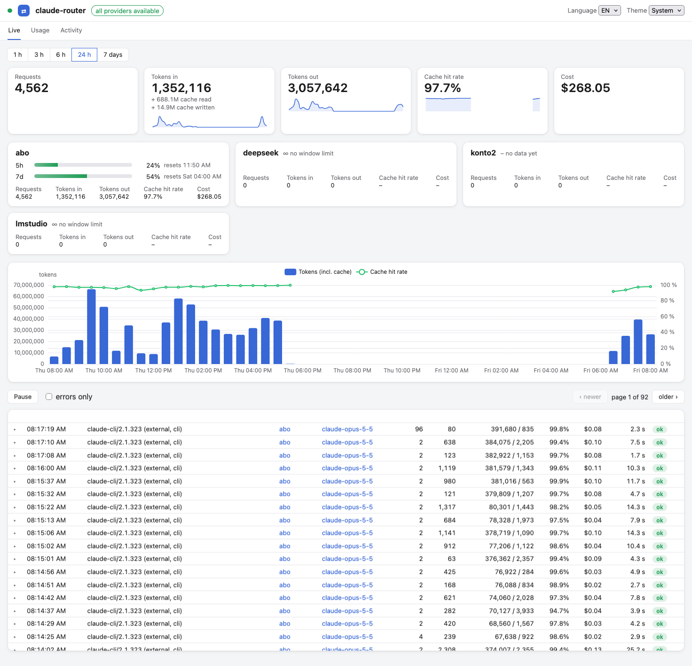

# claude-router

**A local HTTP router between Claude Code and any LLM provider.**

Route by model name, translate Anthropic ↔ OpenAI, fall back automatically when your
subscription runs dry, and see every token and every cent in a built-in dashboard.



## Features

- **One endpoint, many providers.** Claude Code (or any Anthropic-shaped client) talks to
  `http://127.0.0.1:4141`. `/model deepseek:deepseek-chat` goes to DeepSeek and
  `/model subscription:opus-5` goes to your Claude subscription. Requests to local models go to
  LM Studio, Ollama, vLLM or llama.cpp.
- **Format translation.** Anthropic Messages requests, including streaming and tool
  calls, are translated to OpenAI Chat Completions and back. Anthropic providers get
  a byte-for-byte passthrough.
- **Subscription fallback.** When a Claude subscription window is exhausted, requests move
  on to a second account or another provider until the window resets. You can chain as
  many as you like.
- **Usage and cost tracking.** Tokens, cache hits and costs are stored in SQLite and
  split into subscription equivalent and real spend. Prices come from LiteLLM's price list.
- **Web UI.** A live request feed, rate-limit windows per account, usage by
  model/provider/client and an activity heatmap. A full request/response inspector is
  also included, and it's embedded in the binary.
- **Stream watchdog.** Upstream streams that go silent are cut off with a clean SSE error,
  so the client can retry right away instead of hanging.
- **Single static binary** for macOS, Linux and Windows (`CGO_ENABLED=0`).

## How it works

```
Claude Code ──► claude-router :4141 ──┬─► Anthropic (passthrough, subscription or API key)
                  │                   ├─► OpenAI-compatible APIs (translated)
                  │                   └─► local servers: LM Studio, Ollama, vLLM, llama.cpp
                  └─► SQLite (usage, costs, message log) ──► Web UI /ui/
```

The router resolves `provider:model` aliases, picks the provider's auth mode, translates
the request if the provider speaks OpenAI, streams the answer back and records usage.

Next: [Getting started](getting-started.md).
