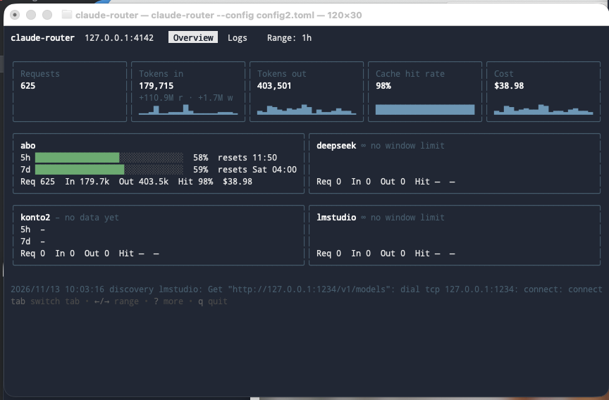

# Reference

## CLI

```bash
claude-router                    # start the router
claude-router stop               # graceful shutdown
claude-router check [provider]   # verify providers
claude-router --help             # help; every subcommand has its own
claude-router completion zsh     # shell completion (bash, zsh, fish)
```

Global flags:

```
--config <path>   config file             (default ~/.config/claude-router/config.toml)
--data <path>     databases and PID file  (default ~/.config/claude-router)
--debug           log every call to the console
--no-tui          plain log output instead of the terminal UI
```

You can run several instances side by side with separate `--data` directories. Each one
keeps its own cost history.

### `--debug`

Logs every call to the console:

- the requested model name and what it resolved to
- the documents of the translation (four on the translated path, two on passthrough)
- path, status and duration

Bodies are capped at 4 KB. This works independently of `log.level`.

### `--no-tui`

When the router runs in the foreground of a terminal, it shows a terminal UI instead of log
lines: an **Overview** tab with request, token, cache hit rate and cost cards (with sparklines
over the selected range) and provider cards with their 5h/7d limits, and a **Logs** tab with
the latest requests. Keys: `Tab`/`1`/`2` switch tabs, `←`/`→` change the time range (Overview),
`↑`/`↓` scroll (Logs), `?` shows all keys, `q` asks before stopping the router, `Ctrl+C` stops it.
On terminals narrower than 60 columns or too short for the cards, the Overview shows a compact table.



`--no-tui` turns this off. Without a terminal (service, pipe, background job) and with
`--debug`, the router always prints plain logs.

### `check`

For every provider with `auth = "key"`, `check` fetches the model list. That confirms in
one go whether `base_url` is right, the environment variable is set and the key is valid:

```
subscription  ?  auth = passthrough — the router holds no credential, checkable only on the first request
deepseek      OK 2 models, 210 ms
```

`passthrough` providers can't be checked, because the router only gets your credential
with the first request. If a provider has no `/v1/models`, `check` falls back to a
one-token request, which requires `models = [...]` in the config. `check` also runs when
the configuration would prevent startup, and says so. It exits with 0 if no checked
provider failed.

### `stop`

On startup the router writes `router.pid` to the data directory. `stop` reads it and sends
`SIGTERM`, the same as `Ctrl+C` in the foreground. It detects and cleans up a stale file
left by a hard kill. If no router is running, that's not an error (exit 0). Windows has no
`SIGTERM`, so stop the router there with `Ctrl+C`.

## HTTP API

| Route | Purpose |
|---|---|
| `POST /v1/messages` | Anthropic-compatible proxy |
| `POST /v1/messages/count_tokens` | Token counting |
| `GET /v1/models` | Aggregated model list for gateway discovery |
| `GET /healthz` | Status and blocked providers |
| `GET /api/usage` | Usage, split into subscription equivalent and real spend |
| `GET /api/stats` | Aggregates for the UI |
| `GET /api/requests` | Request log |
| `GET /api/limits` | Rate-limit windows per provider |
| `GET /api/messages`, `GET /api/messages/{id}` | Message log |
| `GET /api/messages/by-request/{request_id}` | All logged documents of one request |
| `GET /api/config`, `PUT /api/config` | Read and write the configuration |
| `POST /api/models/refresh` | Re-run model discovery |
| `GET /ui/` | Web UI |
