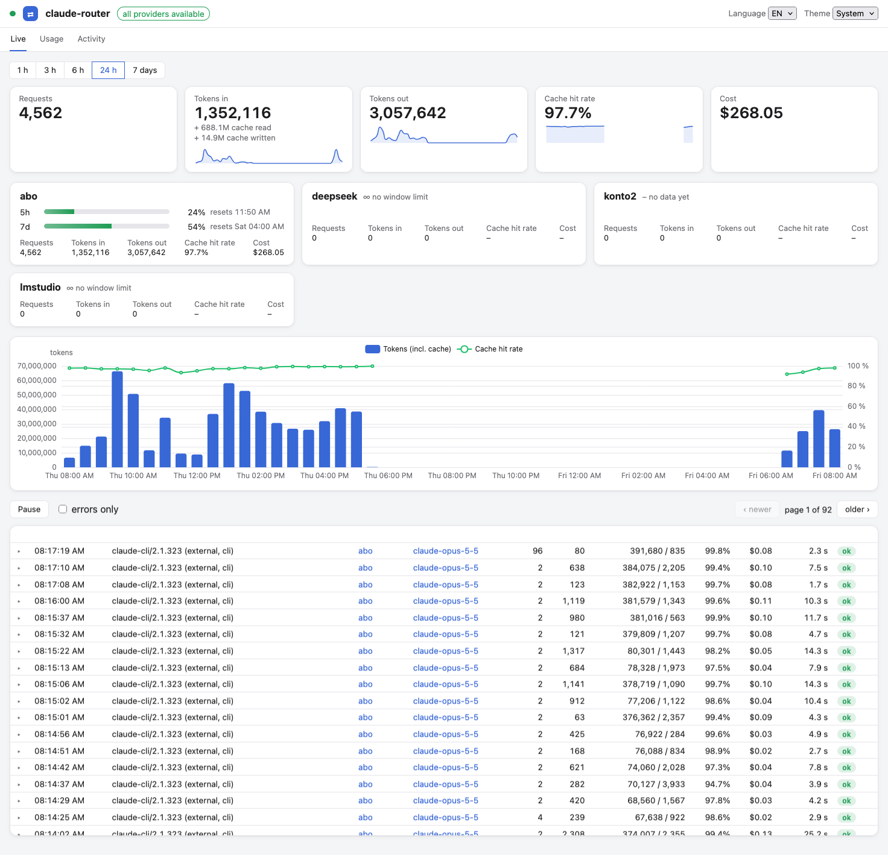

# Web UI

`http://127.0.0.1:4141/ui/` is embedded in the binary.

## Live

- KPIs with sparklines for a selectable range (1 h to 7 days): requests, tokens
  (including cache read and write), cache hit rate and cost.
- One tile per provider. Anthropic providers show their `5h` and `7d` rate-limit windows
  with reset times: yellow from 80 %, red when `rejected`. Translated providers have no
  window limit and show ∞.
- A paginated request table. Click a row to see the logged documents: the request, the
  upstream response, the OpenAI translation if one exists, and the response to the
  client. JSON is pretty-printed and SSE is shown raw.

!!! note
    The request inspector needs `[log] level = "full"`. With `meta`/`off`, or after
    `keep_days`, it shows "nothing logged". Bodies cut at `max_body_kb` are marked as
    truncated.

Cache hit rate is `cache_read / (input + cache_read + cache_write)`.

Rate-limit data comes from the last response's `anthropic-ratelimit-unified-*` headers and
is held in memory only. It's empty after a restart, and for an account that hasn't been
used yet, which shows "no data yet". The same data is available from `GET /api/limits`.

## Usage

Totals for the last 7/30/90 days by model, provider or client, with a cost donut.

## Activity

A calendar of the last 12 months (one cell per UTC day) and a weekday × hour heatmap of
the last 8 weeks (local time), by requests, tokens or cost.

## Theme and language

You can switch between light, dark and system themes in the top right, and the browser
remembers your choice. The UI is in English, with a German translation.

## Access token

When `ROUTER_API_TOKEN` is set, the page asks for the token once and keeps it in
`localStorage`. `/ui/` itself serves only static files. All data comes through `/api/*`,
which is protected (see [Security](security.md)).
